# Architecture & Engineering Guide: `PA-CSE-WEBSITE`

## 1. Overview

`PA-CSE-WEBSITE` is a high-performance departmental web application for the **Department of Computer Science & Engineering** at **P.A. College of Engineering (PACE)**, Mangaluru. 

The application architecture fuses **modern client-side reactivity (React 19 + Vite + Tailwind CSS v4)** with the **vintage Indian print brutalist aesthetic and 3D WebGL observatory** reverse-engineered from **INNOVEX '26** (`codeforinnovex.in`).

---

## 2. Component Hierarchy & Flow

```mermaid
flowchart TD
    App["App.jsx (Root Application)"]
    
    Navbar["Navbar.jsx (Sticky Header & Search Trigger)"]
    SearchModal["SearchModal.jsx (Command Palette - Ctrl+K)"]
    Hero["Hero Section (Poster, SMIL Orbiting Eye & Coordinates)"]
    Tree["BranchedDomainTree.jsx (SVG Circuit Navigation)"]
    Timeline3D["TimelineObservatory3D.jsx (Three.js WebGL Astrolabe)"]
    Faculty["FacultySection.jsx (Dynamic Pill Switcher)"]
    Labs["LabsSection.jsx (Hardware Specifications)"]
    Curriculum["CurriculumSection.jsx (Syllabus Search)"]
    Projects["ProjectsAndEventsSection.jsx (Prototypes & CTF)"]
    Footer["Footer (Brutalist Coordinates & Credits)"]

    App --> Navbar
    App --> SearchModal
    App --> Hero
    App --> Tree
    App --> Timeline3D
    App --> Faculty
    App --> Labs
    App --> Curriculum
    App --> Projects
    App --> Footer

    DataStore[("src/data/cseData.js (Canonical Store)")]
    DataStore -.-> SearchModal
    DataStore -.-> Tree
    DataStore -.-> Timeline3D
    DataStore -.-> Faculty
    DataStore -.-> Labs
    DataStore -.-> Curriculum
    DataStore -.-> Projects
```

---

## 3. Core Subsystems

### A. The Omnibar & Spotlight Search Subsystem
* **State Management**:
  * Global window event listener capturing <kbd>Ctrl+K</kbd>, <kbd>Cmd+K</kbd>, and <kbd>/</kbd>.
  * Local category filter state (`all`, `domains`, `faculty`, `courses`, `labs`, `projects`, `events`).
  * Active selection index tracking with smooth keyboard arrow navigation (<kbd>↑</kbd> / <kbd>↓</kbd>) and auto-scroll into view.
* **Navigation Action**:
  * Selecting an item calls `element.scrollIntoView({ behavior: 'smooth' })` to smoothly land the user at the matching departmental section.

### B. The Branched Circuit Tree Subsystem
* **SVG Vector Engine**:
  * Calculates dynamic bezier and arc curves based on the currently selected specialization track (`index * 46px`).
  * Animates the active reach stroke and positions the glowing saffron pin at the track connector.
* **Dual-Pane Layout**:
  * Left pane: Interactive circuit branch tree.
  * Right pane: Detailed technical specification card with affiliated faculty, labs, and curriculum codes.

### C. The 3D Astrolabe Observatory Subsystem
* **Three.js WebGL Lifecycle**:
  * Renders a mechanical armillary astrolabe clock with high-reflectivity metallic shaders (`MeshStandardMaterial`).
  * Features 12 outer pillars with golden finials, 3 nested concentric rings, and a central celestial core sphere.
  * Provides mouse/touch interaction (drag to inspect the 3D model) alongside automatic orbital spin.
  * Includes a dual view toggle: `3D · OBSERVATORY` vs `2D · JOURNEY` with a flippable 180° hourglass animation.

---

## 4. Performance & Bundle Metrics

* **Production Bundle**:
  * Vite + React: `~283 KB` gzipped to `~84 KB`.
  * Three.js 3D WebGL chunk: isolated to `~545 KB` (only executed when mounting the observatory canvas).
  * CSS: Tailwind CSS v4 compiles into a single ultra-lightweight `~31 KB` (`~6 KB` gzipped) file containing all print shadow math and brutalist utilities.
* **Build Time**: `< 700ms` on modern multicore CPUs.
* **Frame Rate**: Steady **60 FPS** WebGL rendering with RAF throttling when out of viewport.
